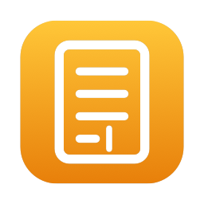
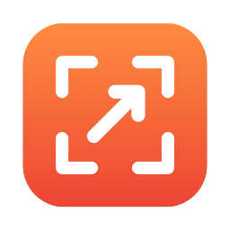
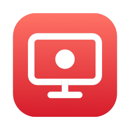
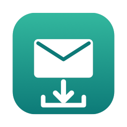
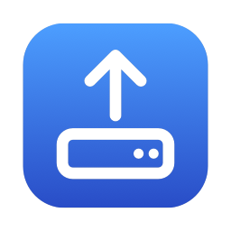
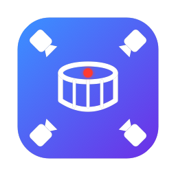

  

<h3 align="center">devstefan.com</h3>

Small, privacy-friendly apps for the Mac. Free, made with care, and everything stays on your Mac.

<a href="https://devstefan.com">devstefan.com</a>

---

| | App | |
|:-:|---|---|
|  | **[NotizEditor](https://github.com/devstefancom/NotizEditor)** | Notes as plain text files – folders, colours for code, several cursors. **Open source.** |
|  | **[Knipser](https://devstefan.com/knipser/)** | Screenshots: capture, mark up, copy. |
|  | **[Filmer](https://devstefan.com/filmer/)** | Record your screen, webcam or audio. |
|  | **[Mail Backup](https://devstefan.com/mailbackup/)** | Save your whole mailbox on your Mac, folders included. |
|  | **[FTP Upload](https://devstefan.com/ftpupload/)** | Put your files on your server – FTP, FTPS and SFTP. |
|  | **[DrumCam](https://devstefan.com/drumcam/)** | Multicam for drummers: iPhones as cameras, the Mac as control room. |

All Mac apps are notarized by Apple. No accounts, no tracking, no data collection.
